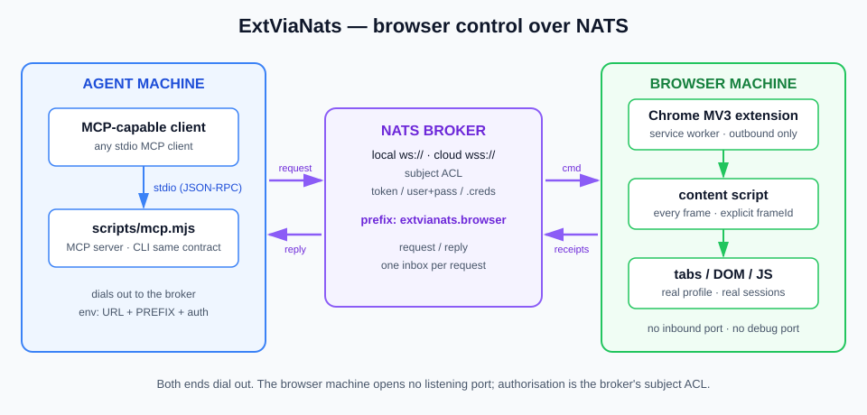
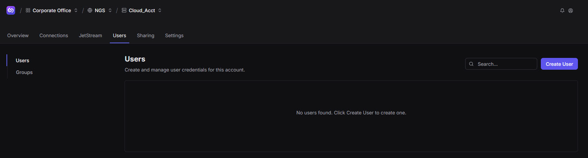
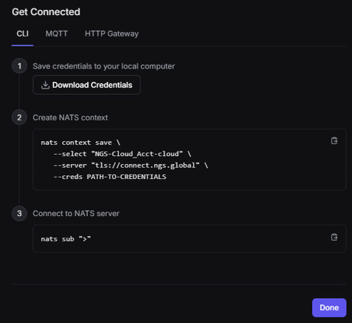
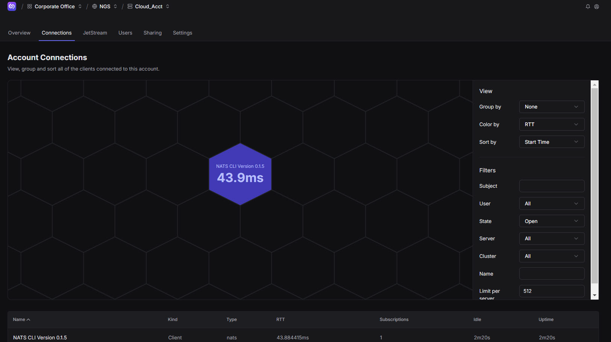
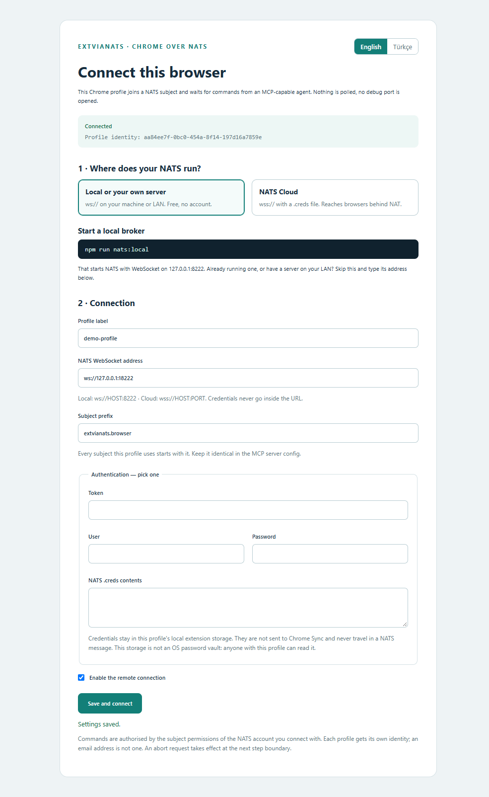
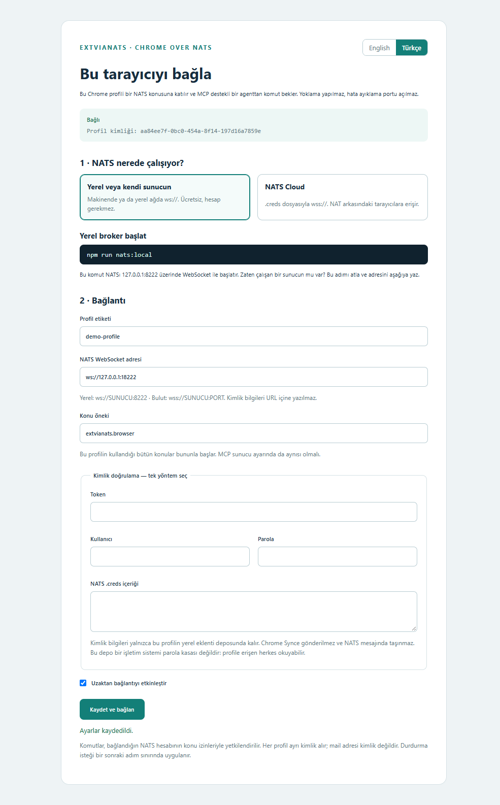
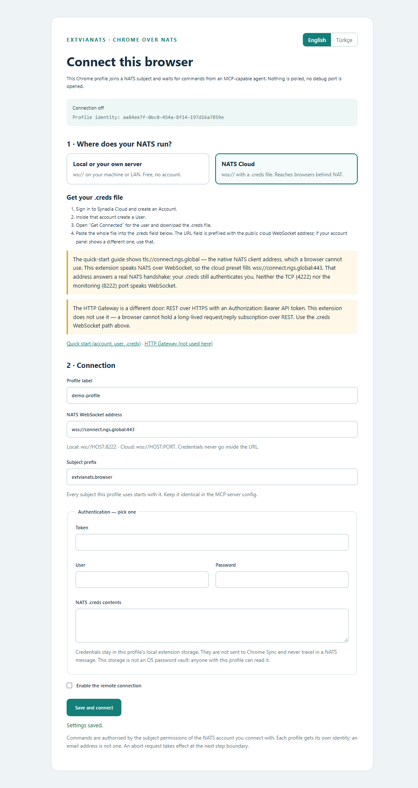
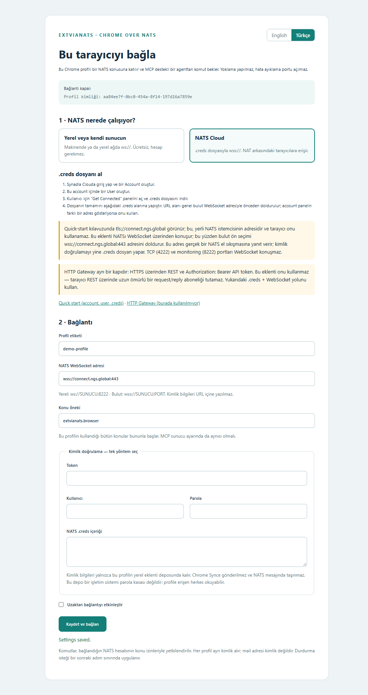

# ExtViaNats

**English** · [Türkçe](README.tr.md)

Connect an MCP-capable client to a **real, already-signed-in Chrome** on another
machine — over NATS. No API, no direct IP connection, no debug port: every command
and receipt travels as NATS request/reply. The broker can be a local `nats-server`
or **NATS Cloud**, so the controlled browser may sit behind NAT with no inbound
access at all.

This repository is a **worked example of using NATS** — request/reply, subject-level
authorisation, and an outbound-only WebSocket — and a starting point for other
projects that need the same shape.

Three small pieces:

- `extension/` — Chrome MV3 extension. Dials **out** to the broker and executes
  browser verbs in the profile's real tabs.
- `scripts/mcp.mjs` — MCP server over stdio. Any MCP-capable client can start it.
- `scripts/remote.mjs` — the same command contract as a plain CLI, for scripts.

## Topology



```text
MCP client ──stdio──> scripts/mcp.mjs ──NATS──> Chrome extension ──> tabs / DOM / JS
 (agent machine)        (controller)   ws:// or wss://   (browser machine)
```

Both ends dial **out** to the broker. The browser machine opens no listening port,
no debug port and no HTTP control surface.

## How it works

1. The MCP client starts `scripts/mcp.mjs` over stdio and calls a tool.
2. The server publishes the command to `extvianats.browser.cmd.<inst>` using a real
   NATS `request()`, so the reply returns to the request's own inbox.
3. The extension's service worker — already connected outbound — validates the
   command, reserves its id, and runs the steps through content scripts in the
   exact tab and frame.
4. A receipt per step returns to the inbox. Progress, registration and heartbeat
   use their own subjects; an arbitrary `reply_to` inside a payload is never honoured.
5. Values that must stay private (form values moved between tabs, script return
   values) are never serialised into a NATS message.

One subject prefix plus one inbox per request is enough. Commands, info and abort
all use the same request/reply line.

## How this differs from other browser control

Most browser automation needs to *reach* the browser: a CDP debug port, a launched
browser process, or a listening relay. That means inbound network access, and
usually a fresh profile — so the user's existing logins are gone.

| Approach | What it needs | What it costs |
|---|---|---|
| CDP (Playwright, Puppeteer) | A debug port, or launching the browser itself | Inbound reachability; usually a fresh profile, existing logins lost |
| `chrome.debugger` extension API | The extension attached as debugger | A persistent "is being debugged" infobar; conflicts with DevTools |
| Local HTTP relay | A listening port plus a tunnel | Another service to secure, another port to expose |
| **ExtViaNats** | An outbound WebSocket to a broker both ends can reach | No inbound port, no infobar, keeps the real profile and its sessions |

The trade-off is honest: you give up CDP's raw power (network interception, OS-level
input, full page lifecycle control) and you depend on a broker. In exchange you can
drive a browser that is already signed in, on a machine you cannot connect to, with
authorisation enforced by the broker's **subject ACL** rather than by network position.

**No Chrome command-line flags are required.** The extension installs through the
normal *Load unpacked* UI.

## Requirements

- Chrome 120+ on Windows or Linux. Real JavaScript (`script`) needs Chrome 135+ and
  the *Allow User Scripts* toggle in the extension details.
- Node.js 22+ for the controller (MCP server / CLI).
- A NATS server with a **WebSocket** listener — local, your own, or cloud.
- Docker, only if you use the `npm run nats:local` helper.

## Build

```bash
npm ci
npm run build
```

`extension/background.js` and `extension/protocol.js` are build output; the sources
are in `src/`. After editing `src/`, rebuild and reload the extension.

## Environment variables

| Variable | Meaning |
|---|---|
| `EXT_VIA_NATS_URL` | `ws://HOST:WS_PORT` or `wss://HOST:PORT`. Default `ws://127.0.0.1:8222` |
| `EXT_VIA_NATS_PREFIX` | Subject prefix. Default `extvianats.browser`. Must match the extension |
| `EXT_VIA_NATS_TOKEN` | Broker token |
| `EXT_VIA_NATS_USER` / `EXT_VIA_NATS_PASS` | Broker user and password |
| `EXT_VIA_NATS_CREDS` | Path to a local `.creds` file (controller only) |

Use exactly **one** authentication method. The extension takes the `.creds`
**content** in its settings page; the controller takes a file **path**.

---

## Two ways to run it

The two options can stay configured side by side because they are different NATS
networks. The rule is per network: one broker, one prefix, matching on both ends.

### Option A — local broker (no account, no secrets)

```bash
npm run nats:local      # Docker, loopback only: ws://127.0.0.1:18222
npm run nats:stop       # stop it again
```

Or without Docker:

```bash
nats-server -c infra/nats-local.conf    # WebSocket on ws://127.0.0.1:8222
```

> **Pick the WebSocket port deliberately.** It is the value inside
> `websocket { port … }`. In a stock `nats-server`, `8222` is the *monitoring HTTP*
> port and `4222` is the *native client TCP* port; neither speaks WebSocket.

Already running a broker, or have one on your LAN? Skip this and type its address
into the extension and the controller. For anything another machine can reach, add
TLS and per-profile credentials — start from `infra/nats-auth.example.conf`.

### Option B — NATS Cloud (remote browser, behind NAT)

The cloud option needs an account and a `.creds` file. The public WebSocket
endpoint is `wss://connect.ngs.global:443`; it answers a real NATS handshake and
requires TLS plus authentication, which your `.creds` provides.

**1 · Create an account and a user.** In the cloud console, create an Account, then
open its **Users** tab and create a User:



**2 · Download the credentials.** Open **Get Connected** for that user. On the
**CLI** tab, use **Download Credentials** to save the `.creds` file:



> **Note:** the same panel's **HTTP Gateway** tab issues a REST *Bearer token*.
> That token cannot be used for a NATS client connection. What NATS needs is the
> `.creds` file (JWT + nkey seed) from the CLI tab.

> **Note:** the [quick-start guide](https://docs.synadia.com/cloud/user-guides/quick-start)
> shows `tls://connect.ngs.global`. That is the **native client** address, which a
> browser cannot use. This extension speaks NATS **over WebSocket**, hence
> `wss://connect.ngs.global:443`. The [HTTP Gateway](https://docs.synadia.com/cloud/http-gateway)
> is REST over HTTPS — a different protocol, not used here.

**3 · Keep the file out of the repository.** Store the real `.creds` outside the
repo (or in a gitignored path) and treat it like a password. The extension wants
its **content** pasted into the settings page; the controller wants its **path**
in `EXT_VIA_NATS_CREDS`.

**4 · Watch the connection live.** The console's **Connections** tab shows both
ends attached to the account:



---

## Install the extension

1. Open `chrome://extensions`.
2. Turn on **Developer mode**.
3. **Load unpacked** → select this project's `extension/` folder.
4. Repeat per Chrome profile you want to control; each gets its own identity.

The manifest carries a fixed public key, so the extension id is identical on
Windows and Linux: `ncfgllpgnoapgbomonfhbmhlcffmmnba`. Do not change the key.

For real JavaScript, open the extension's **Details** and enable
**Allow User Scripts**. That is a UI toggle, not a flag. With it off, every DOM verb
still works and `script` returns a permission error.

## The settings page

Bilingual (English / Türkçe). Pick a preset, fill the connection, save. The status
line reports the live state and shows this profile's exact `inst` — copy it; it is
the only valid command target. An email address is not a profile identity, and
neither is a profile folder name.

| English | Türkçe |
|---|---|
|  |  |
|  |  |

The cloud preset prefills `wss://connect.ngs.global:443` and walks through the
`.creds` steps above. The local preset fills the loopback address and shows the
broker commands.

## MCP configuration

`scripts/mcp.mjs` is a standard **stdio MCP server**, so it works with any
MCP-capable client. Replace `<PROJECT>` with this repository's path and `<CREDS>`
with your credentials file path. Most clients use the `mcpServers` JSON shape;
a few use `servers` with an explicit type, or TOML.

Shareable ready file: [`examples/mcp.json`](examples/mcp.json) (paths are
placeholders — edit them for your machine).

Common `mcpServers` shape:

```json
{
  "mcpServers": {
    "ext-via-nats": {
      "command": "node",
      "args": ["<PROJECT>/scripts/mcp.mjs"],
      "env": {
        "EXT_VIA_NATS_URL": "ws://127.0.0.1:18222",
        "EXT_VIA_NATS_PREFIX": "extvianats.browser"
      }
    }
  }
}
```

`servers` shape (explicit stdio type):

```json
{
  "servers": {
    "ext-via-nats": {
      "type": "stdio",
      "command": "node",
      "args": ["<PROJECT>/scripts/mcp.mjs"],
      "env": {
        "EXT_VIA_NATS_URL": "ws://127.0.0.1:18222",
        "EXT_VIA_NATS_PREFIX": "extvianats.browser"
      }
    }
  }
}
```

TOML shape:

```toml
[mcp_servers.ext-via-nats]
command = "node"
args = ["<PROJECT>/scripts/mcp.mjs"]

[mcp_servers.ext-via-nats.env]
EXT_VIA_NATS_URL = "ws://127.0.0.1:18222"
EXT_VIA_NATS_PREFIX = "extvianats.browser"
```

For the cloud option add `EXT_VIA_NATS_URL = "wss://connect.ngs.global:443"` and
`EXT_VIA_NATS_CREDS = "<CREDS>"` to `env`. Registering the server does not by itself
run any browser command.

### Tools

| Tool | Purpose |
|---|---|
| `ext_via_nats_verbs` | The verb catalog: every `v`, its fields, group, which verbs return page data, and the stable failure codes. Call it before composing steps |
| `ext_via_nats_profiles` | Discover connected profiles and their exact `inst` ids |
| `ext_via_nats_info` | One profile's windows, owned windows, run tags, running command |
| `ext_via_nats_command` | Run a step sequence in one exact profile |
| `ext_via_nats_script` | Run JavaScript in one exact profile and tab; return values never leave the browser |
| `ext_via_nats_screenshot` | Capture a tab's visible area, downscaled in the extension to fit a NATS payload |
| `ext_via_nats_abort` | Stop the running command at the next step boundary; cleanup steps still run |

Agent flow: list profiles → pick the exact `inst` → confirm with `version`/`whoami`
→ run steps. Use a **new command id for new work**.

### CLI

```bash
export EXT_VIA_NATS_URL='ws://127.0.0.1:18222'
npm run remote -- list
npm run remote -- run PROFILE_INST examples/probe.json
```

On Windows PowerShell use `$env:EXT_VIA_NATS_URL = 'ws://127.0.0.1:18222'`.
`examples/probe.json` only runs `version`/`whoami`; `examples/browser.json` opens a
page.

## Verbs

41 verbs in six groups. Full fields, egress marking and failure codes:
[docs/commands.md](docs/commands.md).

| Group | Verbs |
|---|---|
| session (12) | `version` `whoami` `openWindow` `close` `openTab` `closeTab` `navigate` `history` `activate` `hub` `reload` `sleep` |
| discover (5) | `query` `frames` `getText` `getHTML` `screenshot` |
| interact (13) | `click` `dblclick` `rightClick` `hover` `key` `fill` `select` `scroll` `mouseDrag` `drag` `media` `uploadFile` `highlight` |
| verify (3) | `waitFor` `assert` `captcha` |
| value (6) | `relay` `move` `swap` `clear` `setStore` `cookies` |
| page (2) | `inject` `script` |

Every DOM step carries an explicit `frameId` (default `0`). Use `frames` to address
a cross-origin iframe directly instead of letting the first reply win.

`captcha` **detects** a challenge and warns on screen; it never solves it. With
`wait:true` it blocks for a human.

## What stays inside the browser

This is the part worth copying into your own project.

- `relay`, `move`, `swap` read a value in one tab and write it in another **without
  the value ever being serialised out**. Receipts carry a length, never the value.
- `script` return values are not exported — a page's return value could be a token.
- Egress is opt-in and named: `query` with `text:true`, `getText`, `getHTML`,
  `screenshot`. Everything else returns shape, counts and state.
- Cookie reads return **metadata only** and require an explicit scope; an
  unfiltered browser-wide cookie read is refused.
- Receipt URLs are reduced to origin + path, so query strings and pre-signed media
  URLs do not leak.
- Credentials live in the profile's local extension storage, are not sent to Chrome
  Sync, and never travel in a NATS message. That storage is not an OS password vault.

## Execution rules and limits

- **One command per profile at a time.** Another gets `busy`; the same id gets
  `in_progress`.
- The last 100 command ids are kept locally with a SHA-256 of their content. Same
  id + same content returns the stored result; same id + different content is
  `id_conflict`. A restart leaves an uncertain run as `interrupted` — deliberately
  **not** re-executed. This bounded ledger is not an infinite exactly-once guarantee.
- `abort` applies at a step boundary. It does not interrupt a page script already
  running, and cleanup steps still run.
- **NATS Core has no offline queue.** A command published while no extension is
  subscribed is lost. After a timeout, do not blind-retry with a new id: re-send the
  same id and content to read the stored outcome, or call `info` first.
- Window cleanup closes only windows carrying this extension's marker tab, matched
  by `run` tag. It never kills Chrome processes.
- `dnd` suppresses screen takeover (`activate` is refused; `screenshot` is refused
  because a background tab must be raised first). `follow` raises the target tab.

## Verification

```bash
npm run build
npm test
```

`npm test` runs a **real local NATS broker** with **mocked Chrome APIs** and a real
MCP stdio client: profile isolation, command receipts, secret non-egress,
idempotency, abort, worker restart, and the MCP tool surface.

`npm run test:chrome` additionally drives a **real installed Chrome** in an isolated
profile through MCP → NATS → extension: settings UI and live connection, profile
discovery, real DOM fill/assert/click, browser-only value relay, injected button,
real JavaScript through `userScripts`, and marked-window ownership plus cleanup
that preserves the operator's own tab.

`playwright-core` is a dev dependency of that harness only; it is not used by the
product's MCP/CLI path, and the harness's `--enable-unsafe-extension-debugging`
flag is not needed to use the extension.

Measured results, platform coverage and what is still unverified:
[docs/validation.md](docs/validation.md). Mocked-Chrome tests do not substitute for
real browser, Linux or WAN acceptance.

## Security

- Real `.creds` files never enter the repository: `.gitignore` covers `*.creds`,
  `secrets/` and the local scratch directory.
- The local example broker is unauthenticated and loopback-only. Before anything
  else can reach a broker, use `infra/nats-auth.example.conf`: one user per
  profile, narrowed to its own subjects, plus TLS.
- **Broker authority is the real boundary.** A controller credential that can
  publish to a profile's `cmd` subject can drive that browser. The approval
  reminder in the MCP tool description is guidance for the agent, not a
  cryptographic gate.
- A `.creds` file contains a JWT and an nkey seed. Treat it like a password.

## Troubleshooting

- **`no responders`** — no extension is subscribed on that subject. Check the
  profile is open, the extension enabled, and that URL **and prefix** match on both
  ends. NATS Core has no offline queue: a command sent while nobody listens is lost.
- **Status never reaches *connected*** — usually a wrong port (TCP 4222 or
  monitoring 8222 instead of the WebSocket port), missing TLS on `wss://`, or
  rejected credentials.
- **`authorization violation` on cloud** — the creds user's subject permissions do
  not cover your prefix. Widen them in the console or use a permitted prefix.
- **`busy` / `in_progress`** — one command per profile; the same id is still running.
- **`id_conflict`** — the id was already used with different content. Use a new id.
- **`interrupted`** — a previous run with this id has an uncertain outcome; query
  state before deciding, it is not re-executed automatically.
- **`script` permission error** — *Allow User Scripts* is off, or Chrome < 135.
- **`screenshot_too_large`** — the image exceeded the in-worker budget even after
  downscaling; capture a smaller area.
- **Two controllers, doubled replies** — keep one controller per broker+prefix.
  Discovery answers from every connected profile, so duplicate listeners on the
  same command subject would double-execute.

## Docs

- [Setup](docs/setup.md) · [Kurulum](docs/setup.tr.md)
- [Architecture](docs/architecture.md) — topology, subjects, identities, alternatives
- [Command reference](docs/commands.md) — all 41 verbs and failure codes
- [Validation record](docs/validation.md) · [Doğrulama kaydı](docs/validation.tr.md)

Technical references:
[NATS WebSocket client](https://nats-io.github.io/nats.js/core/index.html),
[Chrome WebSocket worker lifetime](https://developer.chrome.com/docs/extensions/how-to/web-platform/websockets),
[Chrome userScripts](https://developer.chrome.com/docs/extensions/reference/api/userScripts),
[NATS authorization](https://docs.nats.io/running-a-nats-service/configuration/securing_nats/authorization).
