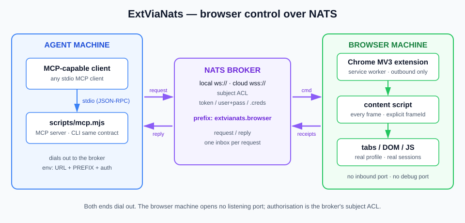
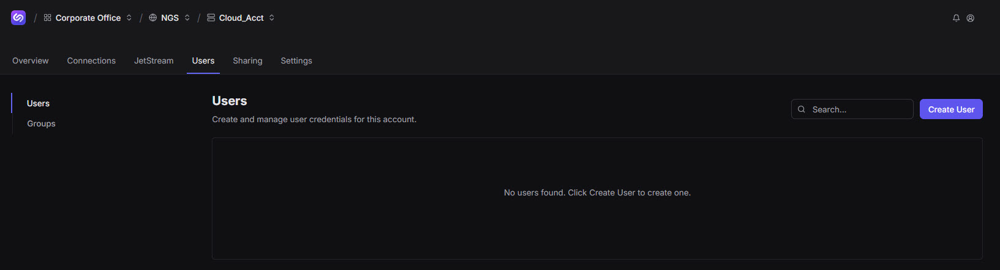
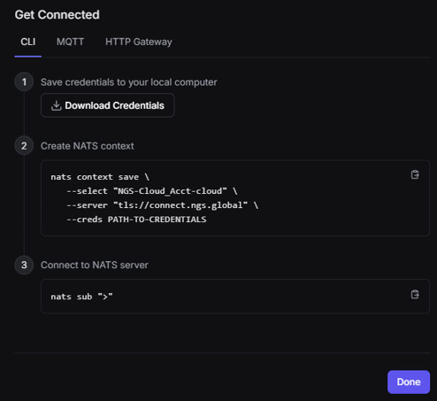
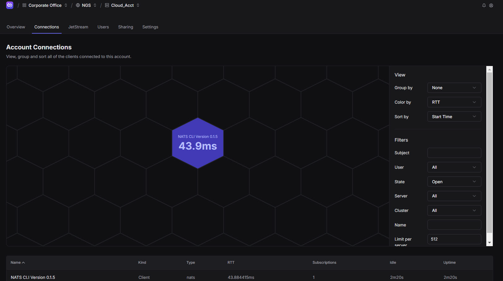
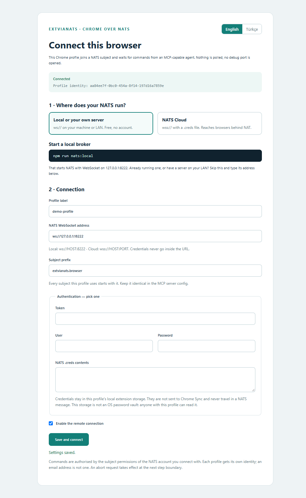
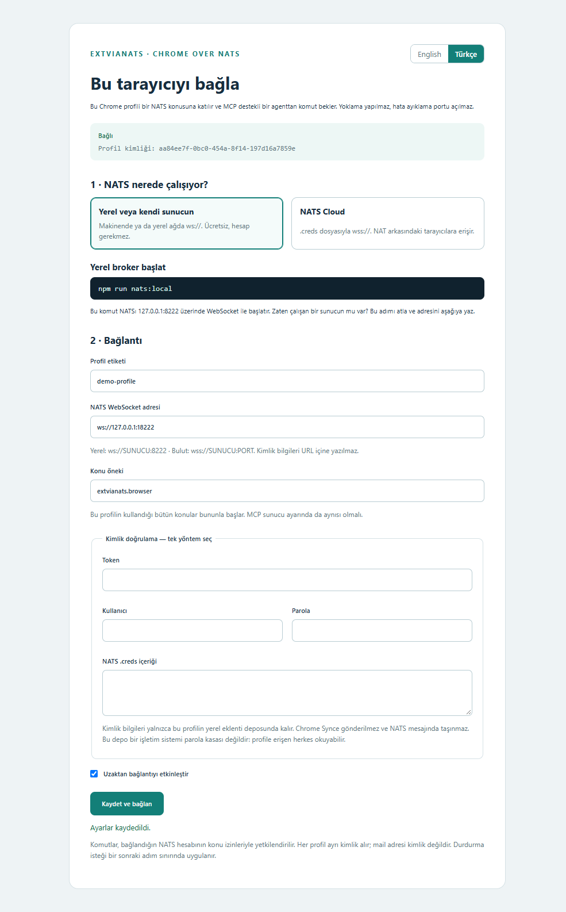
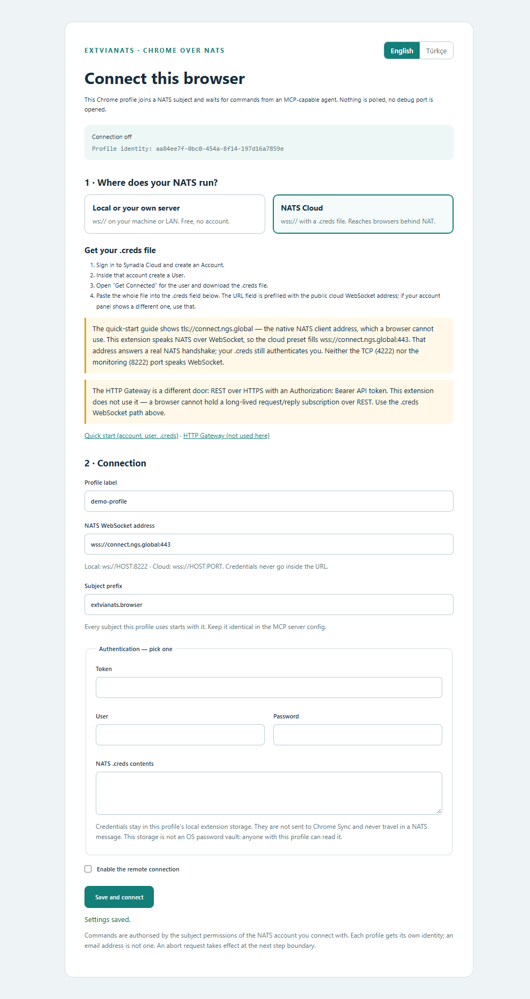
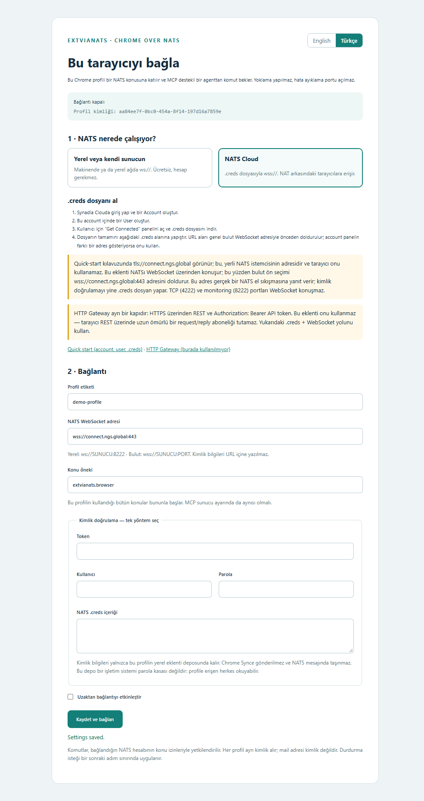

# ExtViaNats

[English](README.md) · **Türkçe**

MCP destekli bir istemciyi, başka bir makinedeki **gerçek, zaten oturum açmış
Chrome**'a bağlayın — NATS üzerinden. API yok, doğrudan IP bağlantısı yok, hata
ayıklama portu yok: her komut ve sonuç NATS request/reply olarak taşınır. Broker
yerel bir `nats-server` ya da **NATS Cloud** olabilir; yani kontrol edilen tarayıcı,
hiçbir gelen bağlantıya izin vermeyen bir NAT arkasında durabilir.

Bu depo **NATS'ın çalışan bir kullanım örneğidir** — request/reply, konu düzeyinde
yetkilendirme ve yalnızca dışarı doğru bağlanan bir WebSocket — ve aynı biçime
ihtiyaç duyan başka projeler için bir başlangıç noktasıdır.

Üç küçük parça:

- `extension/` — Chrome MV3 eklentisi. Broker'a **dışarı doğru** bağlanır ve
  profilin gerçek sekmelerinde tarayıcı verblerini yürütür.
- `scripts/mcp.mjs` — stdio üzerinden MCP sunucusu. MCP destekli her istemci başlatabilir.
- `scripts/remote.mjs` — betikler için aynı komut sözleşmesinin düz CLI hâli.

## Topoloji



```text
MCP istemcisi ──stdio──> scripts/mcp.mjs ──NATS──> Chrome eklentisi ──> sekmeler / DOM / JS
 (ajan makinesi)         (kontrol tarafı)  ws:// veya wss://   (tarayıcı makinesi)
```

İki uç da broker'a **dışarı doğru** bağlanır. Tarayıcı makinesi dinleyen port, hata
ayıklama portu veya HTTP kontrol yüzeyi açmaz.

## Nasıl çalışır

1. MCP istemcisi `scripts/mcp.mjs`'yi stdio ile başlatır ve bir araç çağırır.
2. Sunucu, komutu gerçek bir NATS `request()` ile `extvianats.browser.cmd.<inst>`
   konusuna yayınlar; yanıt isteğin kendi inbox'ına döner.
3. Eklentinin service worker'ı — zaten dışarı doğru bağlı — komutu doğrular, id'sini
   ayırır ve adımları content script'ler üzerinden kesin sekme ve framede yürütür.
4. Adım başına bir sonuç inbox'a döner. İlerleme, kayıt ve heartbeat kendi konularını
   kullanır; yük içindeki keyfi bir `reply_to` asla kabul edilmez.
5. Gizli kalması gereken değerler (sekmeler arasında taşınan form değerleri, script
   dönüş değerleri) hiçbir NATS mesajına serileştirilmez.

Tek konu öneki ve istek başına bir inbox yeterlidir. Komut, info ve abort aynı
request/reply hattını kullanır.

## Diğer tarayıcı kontrol yollarından farkı

Çoğu tarayıcı otomasyonu tarayıcıya *erişmek* zorundadır: bir CDP hata ayıklama
portu, başlatılmış bir tarayıcı süreci veya dinleyen bir relay. Bu, gelen ağ erişimi
demektir ve genelde yeni bir profil demektir — yani kullanıcının mevcut oturumları
gitmiş olur.

| Yaklaşım | Ne gerektirir | Bedeli |
|---|---|---|
| CDP (Playwright, Puppeteer) | Hata ayıklama portu veya tarayıcıyı kendisi başlatmak | Gelen erişilebilirlik; genelde yeni profil, mevcut oturumlar kaybolur |
| `chrome.debugger` eklenti API'si | Eklentinin debugger olarak bağlanması | Kalıcı "hata ayıklanıyor" bilgi çubuğu; DevTools ile çakışır |
| Yerel HTTP relay | Dinleyen port + tünel | Güvenlendirilecek bir servis daha, açılacak bir port daha |
| **ExtViaNats** | İki ucun da erişebildiği bir broker'a dışarı doğru WebSocket | Gelen port yok, bilgi çubuğu yok, gerçek profil ve oturumları korunur |

Takas dürüsttür: CDP'nin ham gücünden (ağ kesme, işletim sistemi düzeyinde girdi,
tam sayfa yaşam döngüsü) vazgeçersiniz ve bir broker'a bağımlı olursunuz. Karşılığında,
zaten oturum açmış bir tarayıcıyı, bağlanamadığınız bir makinede, yetkilendirmesi ağ
konumuyla değil broker'ın **konu ACL**'iyle uygulanan biçimde sürebilirsiniz.

**Hiçbir Chrome komut satırı bayrağı gerekmez.** Eklenti normal *Paketlenmemiş öğe
yükle* arayüzünden kurulur.

## Gereksinimler

- Windows veya Linux üzerinde Chrome 120+. Gerçek JavaScript (`script`) için
  Chrome 135+ ve eklenti ayrıntılarında *Kullanıcı scriptlerine izin ver* seçeneği.
- Kontrol tarafı (MCP sunucusu / CLI) için Node.js 22+.
- **WebSocket** listener'ı olan bir NATS sunucusu — yerel, kendi sunucunuz veya bulut.
- Docker, yalnızca `npm run nats:local` yardımcısını kullanırsanız.

## Derleme

```bash
npm ci
npm run build
```

`extension/background.js` ve `extension/protocol.js` derleme çıktısıdır; kaynaklar
`src/` altındadır. `src/` değiştikten sonra yeniden derleyin ve eklentiyi yeniden yükleyin.

## Ortam değişkenleri

| Değişken | Anlamı |
|---|---|
| `EXT_VIA_NATS_URL` | `ws://SUNUCU:WS_PORT` veya `wss://SUNUCU:PORT`. Varsayılan `ws://127.0.0.1:8222` |
| `EXT_VIA_NATS_PREFIX` | Konu öneki. Varsayılan `extvianats.browser`. Eklentiyle aynı olmalı |
| `EXT_VIA_NATS_TOKEN` | Broker token'ı |
| `EXT_VIA_NATS_USER` / `EXT_VIA_NATS_PASS` | Broker kullanıcısı ve parolası |
| `EXT_VIA_NATS_CREDS` | Yerel `.creds` dosyasının yolu (yalnızca kontrol tarafı) |

Tam olarak **bir** kimlik doğrulama yöntemi kullanın. Eklenti `.creds` **içeriğini**
ayar sayfasında alır; kontrol tarafı dosya **yolunu** alır.

---

## Çalıştırmanın iki yolu

İki seçenek yan yana tanımlı kalabilir, çünkü farklı NATS ağlarıdırlar. Kural ağ
başınadır: bir broker, bir önek, iki uçta aynı.

### Seçenek A — yerel broker (hesap yok, sır yok)

```bash
npm run nats:local      # Docker, yalnızca loopback: ws://127.0.0.1:18222
npm run nats:stop       # tekrar durdur
```

Docker olmadan:

```bash
nats-server -c infra/nats-local.conf    # WebSocket: ws://127.0.0.1:8222
```

> **WebSocket portunu bilinçli seçin.** Port, `websocket { port … }` içindeki
> değerdir. Stok bir `nats-server`'da `8222` *monitoring HTTP* portudur, `4222` ise
> *yerli istemci TCP* portudur; ikisi de WebSocket konuşmaz.

Zaten bir broker çalıştırıyor musunuz veya LAN'da bir sunucunuz mu var? Bu adımı
atlayın ve adresini eklentiye ile kontrol tarafına yazın. Başka bir makinenin
erişebileceği her şey için TLS ve profil başına kimlik bilgisi ekleyin —
`infra/nats-auth.example.conf` ile başlayın.

### Seçenek B — NATS Cloud (uzak tarayıcı, NAT arkasında)

Bulut seçeneği bir hesap ve bir `.creds` dosyası ister. Genel WebSocket adresi
`wss://connect.ngs.global:443`'tür; gerçek bir NATS el sıkışmasına yanıt verir ve
TLS ile kimlik doğrulama ister — kimlik doğrulamayı `.creds` dosyanız sağlar.

**1 · Hesap ve kullanıcı oluşturun.** Bulut konsolunda bir Account oluşturun, sonra
**Users** sekmesini açıp bir User oluşturun:



**2 · Kimlik bilgilerini indirin.** O kullanıcı için **Get Connected** panelini
açın. **CLI** sekmesinde **Download Credentials** ile `.creds` dosyasını kaydedin:



> **Not:** Aynı panelin **HTTP Gateway** sekmesi REST için *Bearer token* üretir.
> Bu token NATS istemci bağlantısında kullanılamaz. NATS'ın ihtiyacı, CLI
> sekmesindeki `.creds` dosyasıdır (JWT + nkey seed).

> **Not:** [Quick-start kılavuzu](https://docs.synadia.com/cloud/user-guides/quick-start)
> `tls://connect.ngs.global` gösterir. Bu, **yerli istemci** adresidir ve tarayıcı
> onu kullanamaz. Bu eklenti NATS'ı **WebSocket üzerinden** konuşur; bu yüzden
> `wss://connect.ngs.global:443`. [HTTP Gateway](https://docs.synadia.com/cloud/http-gateway)
> HTTPS üzerinden REST'tir — farklı bir protokol, burada kullanılmaz.

**3 · Dosyayı depo dışında tutun.** Gerçek `.creds`'yi depo dışında (veya
gitignore'lı bir yolda) saklayın ve parola gibi davranın. Eklenti **içeriğinin**
ayar sayfasına yapıştırılmasını ister; kontrol tarafı **yolunu**
`EXT_VIA_NATS_CREDS` içinde ister.

**4 · Bağlantıyı canlı izleyin.** Konsolun **Connections** sekmesi iki ucun da
hesaba bağlı olduğunu gösterir:



---

## Eklentiyi kurma

1. `chrome://extensions` sayfasını açın.
2. **Geliştirici modu**nu açın.
3. **Paketlenmemiş öğe yükle** → bu projenin `extension/` klasörünü seçin.
4. Kontrol etmek istediğiniz her Chrome profili için tekrarlayın; her biri kendi
   kimliğini alır.

Manifest sabit bir public key taşır; eklenti kimliği Windows ve Linux'ta aynıdır:
`ncfgllpgnoapgbomonfhbmhlcffmmnba`. Key'i değiştirmeyin.

Gerçek JavaScript için eklentinin **Ayrıntılar** sayfasında **Kullanıcı
scriptlerine izin ver** seçeneğini açın. Bu bir arayüz seçeneğidir, bayrak değil.
Kapalıyken bütün DOM verbleri çalışır, `script` izin hatası döner.

## Ayar sayfası

İki dilli (English / Türkçe). Bir ön seçim yapın, bağlantıyı doldurun, kaydedin.
Durum satırı canlı durumu bildirir ve bu profilin kesin `inst` değerini gösterir —
kopyalayın; geçerli tek komut hedefidir. Mail adresi profil kimliği değildir; profil
klasörü adı da değildir.

| English | Türkçe |
|---|---|
|  |  |
|  |  |

Bulut ön seçimi `wss://connect.ngs.global:443` adresini önceden doldurur ve yukarıdaki
`.creds` adımlarını gösterir. Yerel ön seçim loopback adresini doldurur ve broker
komutlarını gösterir.

## MCP yapılandırması

`scripts/mcp.mjs` standart bir **stdio MCP sunucusudur**; MCP destekli her istemciyle
çalışır. `<PROJECT>` yerine bu deponun yolunu, `<CREDS>` yerine kimlik dosyanızın
yolunu koyun. Çoğu istemci `mcpServers` JSON biçimini kullanır; bazıları açık tipli
`servers` veya TOML kullanır.

Paylaşılabilir hazır dosya: [`examples/mcp.json`](examples/mcp.json) (yollar
placeholder'dır — makinenize göre düzenleyin).

Yaygın `mcpServers` biçimi:

```json
{
  "mcpServers": {
    "ext-via-nats": {
      "command": "node",
      "args": ["<PROJECT>/scripts/mcp.mjs"],
      "env": {
        "EXT_VIA_NATS_URL": "ws://127.0.0.1:18222",
        "EXT_VIA_NATS_PREFIX": "extvianats.browser"
      }
    }
  }
}
```

`servers` biçimi (açık stdio tipi):

```json
{
  "servers": {
    "ext-via-nats": {
      "type": "stdio",
      "command": "node",
      "args": ["<PROJECT>/scripts/mcp.mjs"],
      "env": {
        "EXT_VIA_NATS_URL": "ws://127.0.0.1:18222",
        "EXT_VIA_NATS_PREFIX": "extvianats.browser"
      }
    }
  }
}
```

TOML biçimi:

```toml
[mcp_servers.ext-via-nats]
command = "node"
args = ["<PROJECT>/scripts/mcp.mjs"]

[mcp_servers.ext-via-nats.env]
EXT_VIA_NATS_URL = "ws://127.0.0.1:18222"
EXT_VIA_NATS_PREFIX = "extvianats.browser"
```

Bulut seçeneği için `env`'e `EXT_VIA_NATS_URL = "wss://connect.ngs.global:443"` ve
`EXT_VIA_NATS_CREDS = "<CREDS>"` ekleyin. Sunucuyu kaydetmek kendi başına hiçbir
tarayıcı komutu çalıştırmaz.

### Araçlar

| Araç | İşlev |
|---|---|
| `ext_via_nats_verbs` | Verb kataloğu: her `v`, alanları, grubu, hangi verblerin sayfa verisi döndürdüğü ve sabit hata kodları. Adım kurmadan önce çağırın |
| `ext_via_nats_profiles` | Bağlı profilleri ve kesin `inst` kimliklerini keşfet |
| `ext_via_nats_info` | Bir profilin pencereleri, sahip olduğu pencereler, run etiketleri, çalışan komut |
| `ext_via_nats_command` | Bir kesin profilde adım dizisi çalıştır |
| `ext_via_nats_script` | Bir kesin profil ve sekmede JavaScript çalıştır; dönüş değerleri tarayıcıdan çıkmaz |
| `ext_via_nats_screenshot` | Bir sekmenin görünen alanını yakala; NATS yüküne sığması için eklentide küçültülür |
| `ext_via_nats_abort` | Çalışan komutu sonraki adım sınırında durdur; cleanup adımları yine çalışır |

Ajan akışı: profilleri listele → kesin `inst` seç → `version`/`whoami` ile doğrula →
adımları çalıştır. **Yeni iş için yeni komut id** kullanın.

### CLI

```bash
export EXT_VIA_NATS_URL='ws://127.0.0.1:18222'
npm run remote -- list
npm run remote -- run PROFILE_INST examples/probe.json
```

Windows PowerShell'de `$env:EXT_VIA_NATS_URL = 'ws://127.0.0.1:18222'` kullanın.
`examples/probe.json` yalnızca `version`/`whoami` çalıştırır; `examples/browser.json`
bir sayfa açar.

## Verbler

Altı grupta 41 verb. Tam alanlar, egress işaretleri ve hata kodları:
[docs/commands.md](docs/commands.md).

| Grup | Verbler |
|---|---|
| session (12) | `version` `whoami` `openWindow` `close` `openTab` `closeTab` `navigate` `history` `activate` `hub` `reload` `sleep` |
| discover (5) | `query` `frames` `getText` `getHTML` `screenshot` |
| interact (13) | `click` `dblclick` `rightClick` `hover` `key` `fill` `select` `scroll` `mouseDrag` `drag` `media` `uploadFile` `highlight` |
| verify (3) | `waitFor` `assert` `captcha` |
| value (6) | `relay` `move` `swap` `clear` `setStore` `cookies` |
| page (2) | `inject` `script` |

Her DOM adımı açık bir `frameId` taşır (varsayılan `0`). Cross-origin bir iframe'i
doğrudan adreslemek için `frames` kullanın; ilk yanıtın kazanmasına izin vermeyin.

`captcha` bir challenge'ı **tespit eder** ve ekranda uyarır; asla çözmez.
`wait:true` ile insan için bekler.

## Tarayıcı içinde kalanlar

Kendi projenize kopyalamaya değer kısım burasıdır.

- `relay`, `move`, `swap` bir sekmedeki değeri okur ve başka bir sekmede yazar —
  **değer hiçbir zaman serileştirilip dışarı çıkmadan**. Sonuçlar uzunluk taşır,
  değeri değil.
- `script` dönüş değerleri dışarı aktarılmaz — bir sayfanın dönüş değeri bir token
  olabilir.
- Egress isteğe bağlı ve adlandırılmıştır: `text:true` ile `query`, `getText`,
  `getHTML`, `screenshot`. Diğer her şey biçim, sayı ve durum döndürür.
- Çerez okumaları **yalnızca metadata** döndürür ve açık bir kapsam ister; filtresiz
  tarayıcı geneli çerez okuması reddedilir.
- Sonuç URL'leri origin + path'e indirgenir; query string'ler ve önceden imzalı medya
  URL'leri sızmaz.
- Kimlik bilgileri profilin yerel eklenti deposunda kalır, Chrome Sync'e gönderilmez
  ve NATS mesajında taşınmaz. Bu depo bir işletim sistemi parola kasası değildir.

## Yürütme kuralları ve sınırlar

- **Profil başına aynı anda tek komut.** Başkası `busy`, aynı id `in_progress` alır.
- Son 100 komut id'si, içeriklerinin SHA-256'sı ile yerel tutulur. Aynı id + aynı
  içerik saklanan sonucu döndürür; aynı id + farklı içerik `id_conflict`'tir.
  Restart sonrası belirsiz bir çalışma `interrupted` kalır — bilerek **yeniden
  yürütülmez**. Bu sınırlı kayıt, sonsuz bir exactly-once garantisi değildir.
- `abort` adım sınırında uygulanır. Çalışmakta olan bir sayfa scriptini kesmez;
  cleanup adımları yine çalışır.
- **NATS Core'da offline kuyruk yoktur.** Hiçbir eklenti abone değilken yayınlanan
  komut kaybolur. Zaman aşımından sonra yeni id ile kör retry yapmayın: saklanan
  sonucu okumak için aynı id ve içeriği tekrar gönderin veya önce `info` çağırın.
- Pencere cleanup'ı yalnızca bu eklentinin işaret sekmesini taşıyan pencereleri
  kapatır, `run` etiketiyle eşleşir. Chrome süreçlerini asla öldürmez.
- `dnd` ekran devralmayı bastırır (`activate` reddedilir; `screenshot` reddedilir
  çünkü arka plan sekmesinin önce öne alınması gerekir). `follow` hedef sekmeyi öne alır.

## Doğrulama

```bash
npm run build
npm test
```

`npm test`, **taklit Chrome API'leri** ve gerçek bir MCP stdio istemcisiyle **gerçek
bir yerel NATS broker**'ı çalıştırır: profil izolasyonu, komut sonuçları, sır
taşımama, idempotency, abort, worker restart ve MCP araç yüzeyi.

`npm run test:chrome` ek olarak, yalıtılmış bir profilde **gerçek kurulu Chrome**'u
MCP → NATS → eklenti üzerinden sürer: ayar arayüzü ve canlı bağlantı, profil keşfi,
gerçek DOM fill/assert/click, tarayıcı içi değer aktarımı, enjekte düğme,
`userScripts` üzerinden gerçek JavaScript ve operatörün kendi sekmesini koruyan
işaretli pencere sahipliği + cleanup.

`playwright-core` yalnızca bu koşumun geliştirme bağımlılığıdır; ürünün MCP/CLI
yolunda kullanılmaz ve koşumun `--enable-unsafe-extension-debugging` bayrağı
eklentiyi kullanmak için gerekmez.

Ölçülen sonuçlar, platform kapsamı ve hâlâ doğrulanmamış olanlar:
[docs/validation.md](docs/validation.md). Taklit Chrome testleri gerçek tarayıcı,
Linux veya WAN kabulünün yerini tutmaz.

## Güvenlik

- Gerçek `.creds` dosyaları depoya girmez: `.gitignore` `*.creds`, `secrets/` ve
  yerel scratch klasörünü kapsar.
- Yerel örnek broker kimlik doğrulamasız ve yalnızca loopback'tir. Broker'a başka
  bir şey erişebildiğinde `infra/nats-auth.example.conf` kullanın: profil başına bir
  kullanıcı, kendi konularına daraltılmış, artı TLS.
- **Gerçek sınır broker yetkisidir.** Bir profilin `cmd` konusuna yayın yapabilen
  kontrol kimliği o tarayıcıyı sürebilir. MCP araç açıklamasındaki onay hatırlatması
  ajan için rehberdir, kriptografik bir kapı değil.
- Bir `.creds` dosyası JWT ve nkey seed içerir. Parola gibi davranın.

## Sorun giderme

- **`no responders`** — o konuda abone eklenti yok. Profilin açık, eklentinin etkin
  olduğunu ve iki uçta URL **ve önek**in aynı olduğunu kontrol edin. NATS Core'da
  offline kuyruk yoktur: kimse dinlemezken gönderilen komut kaybolur.
- **Durum hiç *bağlı* olmuyor** — genelde yanlış port (WebSocket yerine TCP 4222 veya
  monitoring 8222), `wss://` üzerinde eksik TLS veya reddedilen kimlik bilgisi.
- **Bulutta `authorization violation`** — creds kullanıcısının konu izinleri
  önekinizi kapsamıyor. Konsoldan genişletin veya izinli bir önek kullanın.
- **`busy` / `in_progress`** — profil başına tek komut; aynı id hâlâ çalışıyor.
- **`id_conflict`** — id farklı içerikle zaten kullanılmış. Yeni id kullanın.
- **`interrupted`** — bu id ile önceki çalışmanın sonucu belirsiz; karar vermeden
  önce durumu sorgulayın, otomatik yeniden yürütülmez.
- **`script` izin hatası** — *Kullanıcı scriptlerine izin ver* kapalı veya Chrome < 135.
- **`screenshot_too_large`** — görüntü küçültmeden sonra bile işçi içi bütçeyi aştı;
  daha küçük bir alan yakalayın.
- **İki kontrol tarafı, çift yanıt** — broker+önek başına tek kontrol tarafı tutun.
  Keşif bağlı her profilden yanıt toplar; aynı komut konusundaki yinelenen
  dinleyiciler çift yürütmeye yol açar.

## Belgeler

- [Setup](docs/setup.md) · [Kurulum](docs/setup.tr.md)
- [Mimari](docs/architecture.md) — topoloji, konular, kimlikler, alternatifler
- [Komut referansı](docs/commands.md) — 41 verb ve hata kodları
- [Doğrulama kaydı](docs/validation.tr.md) · [Validation record](docs/validation.md)

Teknik referanslar:
[NATS WebSocket istemcisi](https://nats-io.github.io/nats.js/core/index.html),
[Chrome WebSocket worker ömrü](https://developer.chrome.com/docs/extensions/how-to/web-platform/websockets),
[Chrome userScripts](https://developer.chrome.com/docs/extensions/reference/api/userScripts),
[NATS authorization](https://docs.nats.io/running-a-nats-service/configuration/securing_nats/authorization).
